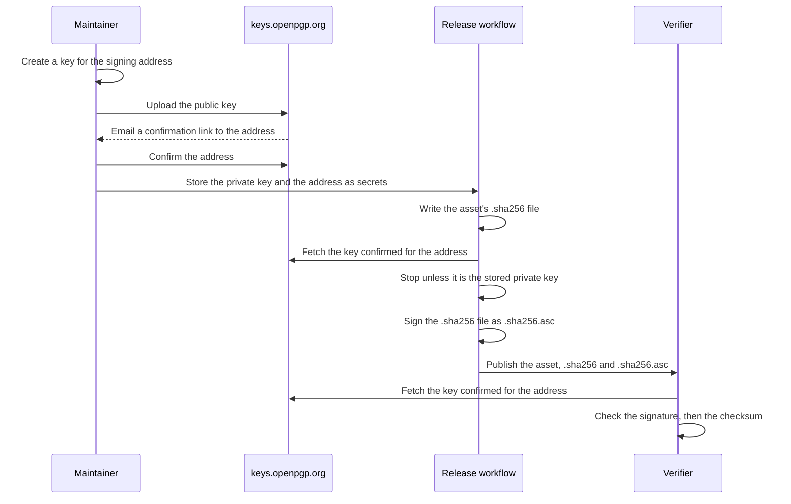

# Release

A project created from Scaffold carries workflows that draft release notes and publish the project's assets. This page is for maintainers of that project. It lists each release workflow and the checks they share, and links to the page that explains how to release each stack.

## Release guide

A project created from Scaffold also carries `RELEASING.md`, a release guide for its own maintainers. `install.sh` writes it with the steps and setup for the selected stacks only. The project owns its release process, so edit `RELEASING.md` whenever the process changes, such as when you add an asset, a registry or a step you run by hand.

## Release workflows

The following table lists each release workflow, the event that starts it and the page that covers it:

| Workflow | File | Starts on | Added when | Page |
|---|---|---|---|---|
| Draft release notes | `draft-release-notes.yml` | A push to `main` or a tag | Release Drafter is selected (on by default) | [Release Drafter](release-drafter.mdx) |
| Release PHP | `release-php.yml` | A version tag | The project is a PHP command app with a PHAR, or a single-file PHP script | [PHP release](../php/release.mdx) |
| Release Node.js | `release-nodejs.yml` | A version tag | Node.js is selected | [Node.js release](../nodejs/release.mdx) |
| Release Docker | `release-docker.yml` | A version tag | Docker is selected (off by default) | [Publishing](../docker/publishing.mdx) |
| Release docs | `release-docs.yml` | A tag or a manual run | The documentation site is selected | [Documentation](../documentation.mdx) |

A PHP class library has no asset to attach, so it has no release workflow.

## Release checks

A version tag is 3 numbers with an optional suffix, such as `1.4.0`, `26.5.1` or `1.4.0-rc.1`. Release PHP, Release Node.js and Release Docker start only on a version tag, and they check the tag before they build anything:

- The tag name is a version.
- The tagged commit is on the default branch.

A tag that fails either check stops the workflow, so nothing gets published from it.

## Release signing

Release PHP and Release Node.js sign every asset they attach. Each workflow writes the asset's SHA-256 checksum to a `.sha256` file and signs that file with the project's GPG key as a `.sha256.asc` file. The public half of the key lives on [keys.openpgp.org](https://keys.openpgp.org) under the project's signing address, and verifiers fetch it from there:



keys.openpgp.org publishes an address on a key only after the address owner confirms it from that mailbox. A signature therefore ties the release to the holder of that mailbox. An attestation ties it only to the repository, so anyone who controls the repository can produce one.

Before a workflow signs, it runs these checks:

1. It imports `GPG_PRIVATE_KEY` and stops unless the secret holds exactly 1 key.
2. It fetches the key that keys.openpgp.org has confirmed for the `RELEASE_GPG_KEY_EMAIL` address.
3. It stops the release when the 2 fingerprints differ.
4. It signs the checksum file and checks the signature with `gpgv` against the keyserver's copy of the key, so a signature by any other key fails.

A key swapped into `GPG_PRIVATE_KEY` alone fails step 3. Anyone who can change both secrets can point the check at an address they control. Verifiers stay protected because the generated `SECURITY.md` names the signing address and fetches the key by it.

A project with a release asset always signs it, so the workflow stops until signing is set up. A project with no release asset, such as a PHP class library, has no release workflow to sign with, and `install.sh` leaves the signing steps and their documentation out.

### Set up signing

keys.openpgp.org links each address to 1 key, so give each project its own signing address. Create a dedicated mailbox, or use plus addressing where your mail provider supports it, such as `you+myproject@example.com`.

To create the key and store it:

1. Create a signing key for the address. `gpg` asks for a passphrase and prints the key's fingerprint:

   ```bash
   gpg --quick-generate-key "myproject releases <SIGNING_ADDRESS>" ed25519 sign 2y
   ```

2. Upload the public key to keys.openpgp.org:

   ```bash
   gpg --export KEY_FINGERPRINT | curl -T - https://keys.openpgp.org
   ```

3. Open the link that the upload prints, and request verification of the address. Confirm it from the email that keys.openpgp.org sends.
4. Store these secrets in the repository's `release` environment:

   | Secret | Value |
   |---|---|
   | `GPG_PRIVATE_KEY` | The armored private key, from `gpg --armor --export-secret-keys KEY_FINGERPRINT` |
   | `RELEASE_GPG_KEY_EMAIL` | The signing address |
   | `GPG_PASSPHRASE` | The key's passphrase |

5. In the project's `SECURITY.md`, replace `SIGNING_ADDRESS` with the signing address.

Replace `SIGNING_ADDRESS` with the signing address and `KEY_FINGERPRINT` with the fingerprint from step 1. The generated `RELEASING.md` holds the same steps with the `gh` commands for the project. To have a reviewer approve each release before the job reads the key, add **Required reviewers** to the `release` environment.

[//]: # (#;< RELEASEDRAFTER)

## Draft release notes

The `Draft release notes` workflow runs the [`release-drafter/release-drafter`](https://github.com/release-drafter/release-drafter) action, and its token has write access to contents and pull requests. See [Release Drafter](release-drafter.mdx).

[//]: # (#;> RELEASEDRAFTER)
