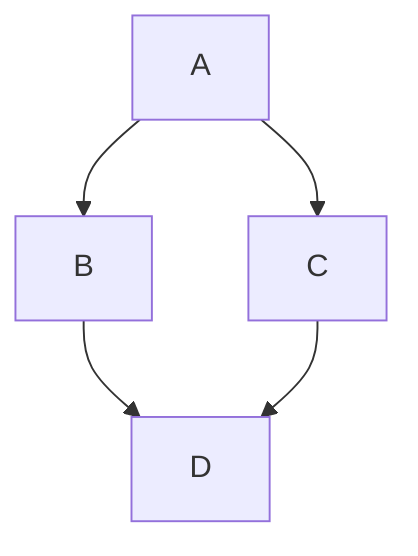

# Documentation

Scaffold ships a [Docusaurus](https://docusaurus.io/) documentation site in the generated project's `docs/` directory. `init.sh` asks **Use docs** and keeps the site unless you answer no. Non-interactively, pass `--docs` or `--no-docs` to `init.sh`. This page is for developers who maintain that site. It covers diagrams, spell checking, previews, publishing and terminal recordings.

The Scaffold documentation you're reading uses the same setup and is hosted on [GitHub Pages](https://pages.github.com/).

[//]: # (#;< META)

You can reuse the configuration and structure of this site for your own project.

[//]: # (#;> META)

To change the site's title, URL, navigation or theme, edit the [configuration file](https://github.com/AlexSkrypnyk/scaffold/blob/main/docs/docusaurus.config.js), `docs/docusaurus.config.js`.

## Diagrams

The shipped configuration file sets `markdown.mermaid`, so the site renders [Mermaid](https://mermaid.js.org/) diagrams. To add a diagram, write its Mermaid source in a code block tagged `mermaid`. This page holds such a block, and the site renders it as the following diagram:



For the full syntax, see the [Mermaid syntax documentation](https://mermaid.js.org/intro/syntax-reference.html).

## Spell checking

[CSpell](https://cspell.org/) checks every `.mdx` page in `docs/content/` against a [custom configuration file](https://github.com/AlexSkrypnyk/scaffold/blob/main/docs/cspell.json).

To check the spelling of the documentation, run the following command in `docs/`:

```bash
npm run spellcheck
```

## Netlify previews on pull requests

The [Test Docs](https://github.com/AlexSkrypnyk/scaffold/blob/main/.github/workflows/test-docs.yml) GitHub Action builds and tests the site on every push to `main`. It also runs on every pull request whose base branch is `main` or matches `feature/**`. When the repository has 2 Netlify secrets, the action deploys each build to Netlify and comments the preview link on each pull request.

To set up the Netlify deploy:

1. Set up a new site on Netlify.
2. In your GitHub repository's settings, add 2 secrets under **Secrets and variables > Actions > Repository secrets**:

   - `NETLIFY_SITE_ID`: the ID from **Site > Site configuration > General > Site details > Site information > Site ID** on Netlify
   - `NETLIFY_AUTH_TOKEN`: a token from **User settings > Applications > Personal access tokens > New access token** on Netlify

3. Open a pull request. Confirm that the action comments a link to the deployed preview.

## GitHub Pages on release

The [Release docs](https://github.com/AlexSkrypnyk/scaffold/blob/main/.github/workflows/release-docs.yml) GitHub Action builds the site on every tag push. You can also run it manually and enter a version. The site footer shows the tag name, or the version you entered on a manual run.

In the shipped action, the steps that upload and deploy the site are commented out. To publish the site to GitHub Pages on each release, uncomment the `Upload documentation site` and `Deploy documentation site` steps at the end of `.github/workflows/release-docs.yml`.

The action runs in the `pages` concurrency group. Starting a new run cancels any run in progress, so only the most recent run deploys. The job deploys to the `github-pages` environment. That environment takes its URL from the `Setup GitHub pages` step.

## Terminal recordings

Scaffold ships an [`AsciinemaPlayer`](https://github.com/AlexSkrypnyk/scaffold/blob/main/docs/src/components/AsciinemaPlayer/AsciinemaPlayer.js) React component that embeds interactive [asciinema](https://asciinema.org/) terminal recordings in your pages.

To add a recording to a page:

1. In `docs/`, record a session to a cast file under `static/img/`:

   ```bash
   asciinema rec --output-format asciicast-v2 static/img/demo.cast
   ```

2. Embed the player in any `.mdx` page:

   ```jsx
   import AsciinemaPlayer from '@site/src/components/AsciinemaPlayer';

   <AsciinemaPlayer src="/img/demo.cast" autoPlay loop controls />
   ```

The component loads the player's script and styles only in the browser, so the server-side build can render pages that use it. It passes the following props to the player:

| Prop | Default |
|---|---|
| `src` | None. Set it to the cast file's path without `static`, such as `/img/demo.cast`. |
| `autoPlay` | `false` |
| `loop` | `false` |
| `controls` | `true` |
| `preload` | `true` |
| `theme` | `asciinema` |
| `poster` | None |
| `startAt` | None |
| `terminalLineHeight` | `1.0` |
| `terminalFontFamily` | `Consolas, "Courier New", Courier, "Liberation Mono", monospace` |

Any other prop goes to the `div` that holds the player.
