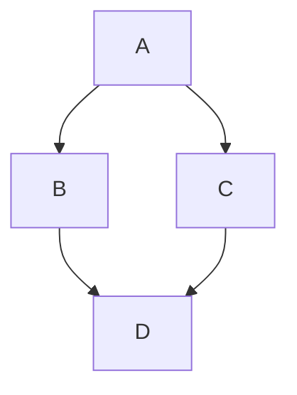

# Documentation

Scaffold ships a [Docusaurus](https://docusaurus.io/) documentation site in the generated project's `docs/` directory. This page is for developers who maintain that site. Follow it to add diagrams and terminal recordings, check spelling, preview pull requests and publish the site.

`install.sh` keeps the site unless you answer `n` to the **Use docs** prompt. Non-interactively, pass `--docs` to keep it or `--no-docs` to remove it.

Run every command on this page in `docs/`, after `npm install`. To change the site's title, URL, navigation or theme, edit its [configuration file](https://github.com/AlexSkrypnyk/scaffold/blob/main/docs/docusaurus.config.js), `docs/docusaurus.config.js`.

The Scaffold documentation you're reading uses the same setup and is hosted on [GitHub Pages](https://pages.github.com/).

[//]: # (#;< META)

You can reuse the configuration and structure of this site for your own project.

[//]: # (#;> META)

## Add a diagram

The site renders [Mermaid](https://mermaid.js.org/) diagrams, because the configuration file sets `markdown.mermaid` and loads the `@docusaurus/theme-mermaid` theme. To add a diagram, write its Mermaid source in a code block tagged `mermaid`:

````md

````

The site renders that block as the following diagram:


For the full syntax, see the [Mermaid syntax documentation](https://mermaid.js.org/intro/syntax-reference.html).

## Check spelling

[CSpell](https://cspell.org/) checks every `.mdx` page in `docs/content/` against a [custom configuration file](https://github.com/AlexSkrypnyk/scaffold/blob/main/docs/cspell.json), `docs/cspell.json`. The [Test Docs](https://github.com/AlexSkrypnyk/scaffold/blob/main/.github/workflows/test-docs.yml) workflow runs the same check, so a misspelled word fails the workflow.

To check spelling, run the following command:

```bash
npm run spellcheck
```

To accept a word CSpell doesn't know, add it to the `words` list in `docs/cspell.json`.

## Preview pull requests on Netlify

The Test Docs workflow builds and tests the site on every push to `main`. It also runs on every pull request into `main` or into a branch that matches `feature/**`. When the repository has the `NETLIFY_SITE_ID` and `NETLIFY_AUTH_TOKEN` secrets, the workflow deploys each build except scheduled runs to Netlify and comments the preview link on the pull request. GitHub doesn't pass these secrets to pull requests from forks, so those get no preview.

To set up Netlify previews:

1. Create a site on Netlify.
2. In your GitHub repository, click **Settings > Secrets and variables > Actions**.
3. Add 2 repository secrets:

   - `NETLIFY_SITE_ID`: the ID of your Netlify site
   - `NETLIFY_AUTH_TOKEN`: a Netlify personal access token

4. Open a pull request. Confirm that the workflow comments a link to the deployed preview.

## Publish the site to GitHub Pages

The [Release docs](https://github.com/AlexSkrypnyk/scaffold/blob/main/.github/workflows/release-docs.yml) workflow builds the site when you push a tag whose name has no `/`. You can also start it by hand from the **Actions** tab and enter a **Release version**. The site footer shows the tag name, or the version you entered.

The workflow's upload and deploy steps ship commented out. To publish the site to GitHub Pages on each release, uncomment the `Upload documentation site` and `Deploy documentation site` steps at the end of `.github/workflows/release-docs.yml`.

The workflow runs in the `pages` concurrency group, so a new run cancels any run in progress. With the steps uncommented, only the most recent run deploys. The job deploys to the `github-pages` environment and sets its URL from the `Setup GitHub pages` step.

## Embed a terminal recording

The [`AsciinemaPlayer`](https://github.com/AlexSkrypnyk/scaffold/blob/main/docs/src/components/AsciinemaPlayer/AsciinemaPlayer.js) React component embeds an interactive asciinema terminal recording in a page.

To add a recording to a page:

1. With the [asciinema](https://asciinema.org/) CLI, record a session to a cast file under `docs/static/img/`:

   ```bash
   asciinema rec --output-format asciicast-v2 static/img/demo.cast
   ```

2. Embed the player in any `.mdx` page:

   ```jsx
   import AsciinemaPlayer from '@site/src/components/AsciinemaPlayer';

   <AsciinemaPlayer src="/img/demo.cast" autoPlay loop controls />
   ```

3. Run `npm start`.
4. Open the page. Confirm that the player shows the recording.

The component loads the asciinema player's script and styles from the jsDelivr CDN. It loads them only in the browser, so the server-side build can render pages that use it. The following table lists the props the component passes to the player:

| Prop | Default |
|---|---|
| `src` | None. Set it to the cast file's path without `docs/static`, such as `/img/demo.cast`. |
| `autoPlay` | `false` |
| `loop` | `false` |
| `controls` | `true` |
| `preload` | `true` |
| `theme` | `asciinema` |
| `poster` | None |
| `startAt` | None |
| `terminalLineHeight` | `1.0` |
| `terminalFontFamily` | `Consolas, "Courier New", Courier, "Liberation Mono", monospace` |

The component passes any other prop to the `div` that holds the player.
